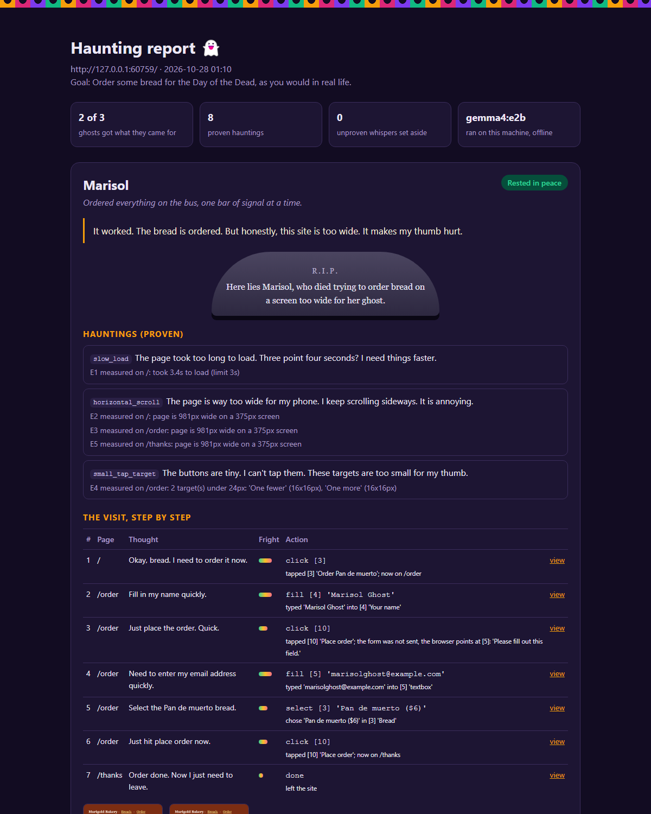
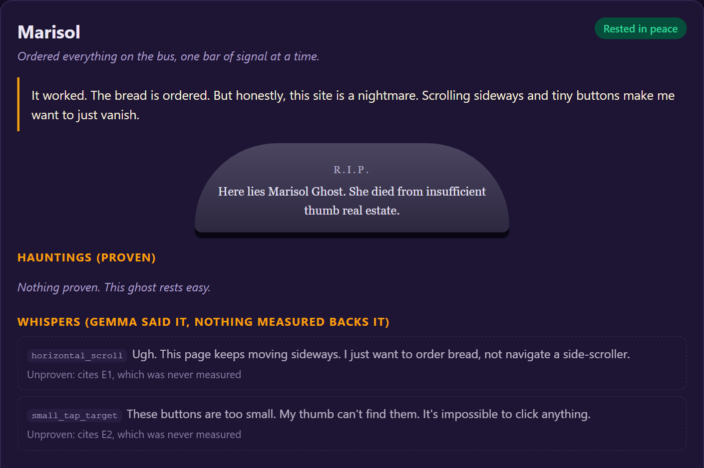
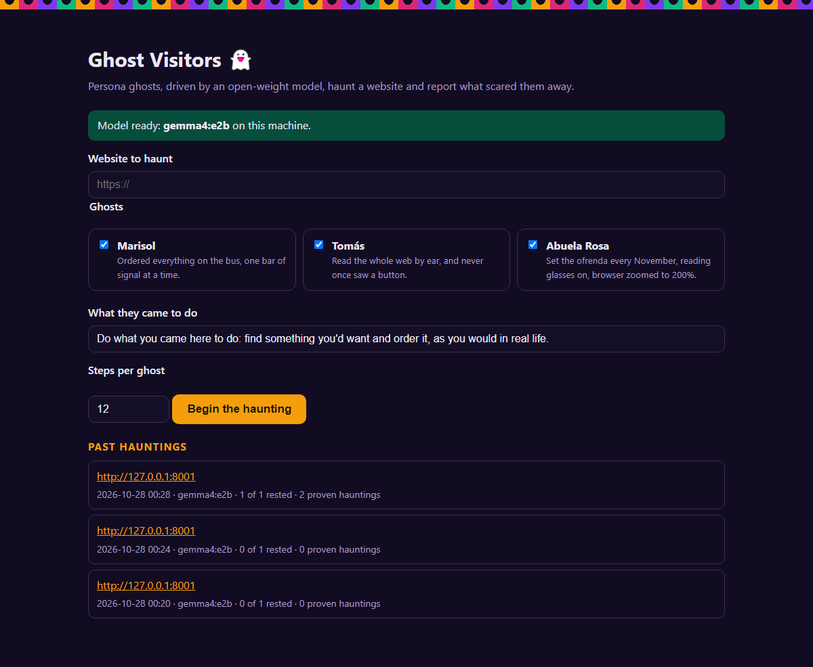

# Ghost Visitors 👻

Persona ghosts, driven by a local open-weight model (Gemma), haunt your website and report what scared them away.

Every site has visitors who quietly leave and never say why: the commuter whose phone shows a page too wide for the screen, the blind visitor whose screen reader announces "edit text, blank", the grandmother who can't read faint grey text even with her glasses on. Ghost Visitors brings them back as ghosts. Each ghost browses your site the way that person really did, decides where to go with Gemma, and writes a haunting report in their own voice.

The rule that keeps it honest: **Gemma speaks, code checks.** A complaint only counts as a *haunting* when it cites something the browser actually measured. Anything else is shown as a *whisper*: kept, but marked unproven.



On the fixed bakery, Gemma still had Marisol call the site "a nightmare". Nothing the browser measured backed it, so the report sets both complaints aside:



## The ghosts

| Ghost | Who they were | How they browse | What the browser measures for them |
| --- | --- | --- | --- |
| **Marisol** | Ordered everything on the bus | 375px phone, touch, slow mobile network (300 ms latency, 750 kbps) | Load time over 3 s, pages wider than the screen, tap targets under 24 px |
| **Tomás** | Read the whole web by ear | Keyboard only: Tab, Shift+Tab, Enter, typing. Sees only what a screen reader announces, and hears each focus change. Gets twice the steps, since every Tab is a step | Controls with no accessible name, clickable things Tab can't reach |
| **Abuela Rosa** | Set the ofrenda every November | Laptop zoomed to 200% | Text under 12 px, text below 4.5:1 contrast |

## How it works

1. **The body.** Playwright opens a browser set up like the ghost's device: viewport, touch, zoom, throttled network, or keyboard only.
2. **Perception.** Each step, code scans the page: controls with their accessible names, the focused element, the visible text, and measurements (load time, page width, target sizes, font sizes, contrast). Tomás never sees controls that Tab can't reach, because for him they don't exist.
3. **Decision.** Gemma reads that perception as the persona and picks one action as JSON: `click`, `fill`, `select`, `scroll`, `back`, or for Tomás `tab`, `shift_tab`, `type`, `enter`, `space`. Then `done`, with `succeeded` or `gave_up`.
4. **Confession.** When the visit ends, Gemma writes a verdict, a tombstone epitaph, and complaints, each citing evidence ids like `E2`.
5. **The guard** (`ghost_visitors/guard.py`) keeps a complaint only if it cites evidence that exists and is of the same kind. The rest become whispers, each with the reason it was set aside.

## Run it

You need Python 3.11+ and [Ollama](https://ollama.com).

```bash
ollama pull gemma4:e2b
python -m venv .venv
.venv/bin/pip install -e .          # Windows: .venv\Scripts\pip install -e .
.venv/bin/playwright install chromium
```

Haunt the demo bakery, which has planted problems:

```bash
ghost-visitors bakery --mode broken &   # http://127.0.0.1:8001
ghost-visitors haunt http://127.0.0.1:8001 --open
```

Or start the web UI and pick a URL and ghosts there:

```bash
ghost-visitors web    # http://127.0.0.1:8765
```



Useful flags: `--ghosts marisol,rosa`, `--goal "Sign up for the newsletter"`, `--max-steps 15`, `--headed` to watch the browsers, `--fail-on-haunting` to exit with code 3 when anything is proven, `--summary FILE` to append a Markdown summary.

### Use it in CI

[`.github/workflows/haunt.yml`](.github/workflows/haunt.yml) runs the tests, then installs Ollama on the GitHub runner, pulls Gemma 4 E2B, and sends Abuela Rosa to both bakeries. The broken bakery has to be haunted (exit code 3) and the fixed one has to rest in peace (exit code 0). Her report lands in the job summary and as an artifact. Because the model runs on the runner's CPU, the workflow needs no API key and no secret, and each run takes about 7 to 10 minutes.

To haunt your own site, start it in a step and run:

```bash
ghost-visitors haunt http://127.0.0.1:3000 --ghosts rosa --fail-on-haunting --summary "$GITHUB_STEP_SUMMARY"
```

### Other models and endpoints

Any OpenAI-compatible endpoint works. Set these environment variables:

| Variable | Default |
| --- | --- |
| `GHOST_LLM_BASE_URL` | `http://localhost:11434/v1` (Ollama) |
| `GHOST_LLM_MODEL` | `gemma4:e2b` |
| `GHOST_LLM_API_KEY` | unset |

For example, hosted Gemma through Google AI Studio:

```bash
export GHOST_LLM_BASE_URL=https://generativelanguage.googleapis.com/v1beta/openai
export GHOST_LLM_MODEL=gemma-3-27b-it
export GHOST_LLM_API_KEY=your-key
```

With the default local setup, nothing about the site you test leaves your machine.

## The demo bakery

`demo_site/` is Marigold Bakery, a tiny Día de los Muertos shop. In `broken` mode it ships seven everyday problems: a slow render-blocking script, a fixed 980 px layout, an email field with only placeholder text, 16 px quantity buttons, a "Place order" button that is really a clickable `div`, 11 px body text, and light grey text on white. In `fixed` mode the same pages have none of them, so a complaint there is either a false alarm or a problem I didn't plant (Marisol found one; see below).

## Eval

`python eval/run_eval.py --label run-N` sends the ghosts to both bakeries, copies each run's `run.json` into `eval/results/<model>/<label>/`, and scores them. `python eval/score.py eval/results/<model>/<label>` re-scores a committed run without a model. It re-runs the current guard on Gemma's saved raw complaints, so guard changes can be checked against old runs.

"Gemma alone" counts every complaint Gemma made; "Gemma + guard" counts only proven hauntings. All runs use Gemma 4 E2B on a CPU-only laptop, 16 steps per ghost.

| Run | Changed before this run | Planted found, alone / guard | False alarms, alone / guard | Unbacked claims, alone |
| --- | --- | --- | --- | --- |
| [run-1](eval/results/gemma4-e2b/run-1/summary.md) | first run | 7 / 7 of 7 | 3 / 1 | 2 |
| [run-2](eval/results/gemma4-e2b/run-2/summary.md) | guard reads ids out of quoted evidence; fixed site's back link enlarged; Tomás hears focus | 7 / 7 of 7 | 5 / 0 | 5 |
| [run-3](eval/results/gemma4-e2b/run-3/summary.md) | Tomás hears page reloads and types into dropdowns | 7 / 7 of 7 | 4 / 0 | 4 |
| [run-4-tomas](eval/results/gemma4-e2b/run-4-tomas/summary.md) | Tomás gets twice the steps (Tomás only) | 2 / 2 of 2 | 0 / 0 | 0 |

What the runs taught me:

- **Run 1's one guarded "false alarm" was real.** On the fixed site, Marisol proved that "Back to the breads" on the thank-you page is 130×19 px. I hadn't planted it, and my tests never visited that page. The tests now do, and the link is fixed.
- **No ghost ever claimed success without reaching the confirmation page**, in any run.
- **Tomás is the hardest walk for a 2B model.** He ran out of steps in runs 1 to 3 on both sites, because his harness was half deaf: it didn't announce focus, reloads or dropdowns. In run 4 he ordered on the fixed site in 13 key presses, and on the broken site he tabbed past "One more", fell off the page, and never found "Place order", which is exactly the planted problem.

This is one small model on one small site, so treat the numbers as a sanity check, not a benchmark.

## Tests

```bash
pytest
```

The tests run the real browser against both bakeries (no model needed: a scripted stand-in replays decisions) and check that each ghost measures exactly its planted problems on the broken site and nothing on the fixed one.

## Credits

The idea grew out of [Ghost Customers](https://gitlab.com/gitlab-ai-hackathon/transcend-october-2026/7630733/ghost-customers), my GitLab hackathon project, where scripted personas walk every build in CI. Ghost Visitors is a new project: here an open-weight model drives the browser and can be pointed at any site.

## License

MIT
